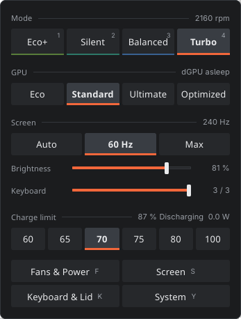
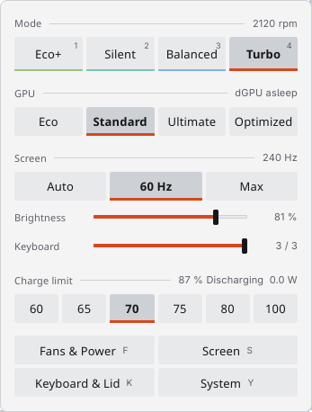

# tspmo

Thermal & System Power Management Optimizer: a G-Helper-style control app for **ASUS** laptops
on Linux (ROG, TUF, Zenbook, Vivobook, ProArt), built for long battery life. A small root
daemon (`tspmod`) applies power modes, GPU modes, fan curves, power limits, charge limits and
lighting; a CLI (`tspmo`), a popup GUI (`tspmo-gui`, opened from the ROG key) and a Plasma
widget control it. Lenovo support is early.

<p align="center">
  
  
</p>

**Tested on:** ASUS ROG Zephyrus G16 GU605MI. Other models work through capability detection
(it reads what the kernel exposes), but only that machine is tested. Anything else may lack
features: run `tspmo info`.

## Features
- Four power modes (Eco+, Silent, Balanced, Turbo); Fn+F5 cycles them. Replaces
  power-profiles-daemon and speaks its D-Bus API.
- GPU modes (Eco, Standard, Ultimate, Optimized) that never wake a sleeping dGPU.
- Fan curves, power limits, battery charge limit, firmware toggles.
- Keyboard lighting, Slash and AniMe Matrix lid displays, software Fn-lock.
- Screen: refresh rate, flicker-free dimming, colour, eye care.
- No polling: 0 wakeups/s at idle; the GUI exits when closed.
- `tspmo doctor` finds what wastes battery and prints the fix; `tspmo bench` measures it.

## Install
```sh
curl -fsSL https://raw.githubusercontent.com/keepvaibin/tspmo/master/install.sh | sh
```
Arch-based systems get the `.pkg.tar.zst` packages; others get a tarball installed into `/usr`.
Needs systemd, D-Bus and polkit. Checks SHA256SUMS. Refuses on non-ASUS hardware unless
`--force`; `--dry-run` shows what it would do. Log out and back in once afterwards.
Details: [docs/install.md](docs/install.md).

## Uninstall
```sh
curl -fsSL https://raw.githubusercontent.com/keepvaibin/tspmo/master/install.sh | sh -s -- --uninstall
```
Stops the daemon, removes everything tspmo wrote, and re-enables power-profiles-daemon.

## Build from source
```sh
cargo build --release
cd packaging/arch && makepkg -si      # Arch package of the working tree
```
Needs Rust 1.85+, fontconfig, libxkbcommon and wayland development files.

## CLI
```sh
tspmo info                  # what this laptop exposes
tspmo status                # profile, power source, GPU mode
tspmo profile [mode|cycle]  # eco-plus | silent | balanced | performance
tspmo gpu [eco|hybrid|ultimate|optimized]
tspmo gpu users             # apps keeping the NVIDIA GPU awake
tspmo fans | limits | battery | light | lid | display
tspmo doctor [--apply]      # problems and fixes
tspmo bench help
tspmo-gui --install-shortcut   # bind the ROG key
tspmo-run <program>            # run on the NVIDIA GPU
```

## Report your hardware
```sh
tspmo dump ./my-laptop && tar -C my-laptop -czf dump.tar.gz .
```
Attach `dump.tar.gz` to an issue. It holds no serial numbers, UUIDs or MAC addresses, and
becomes a test fixture.

## License
GPL-3.0-or-later. The DKMS driver patch is GPL-2.0-only.

## Credits
See [docs/credits.md](docs/credits.md): asusctl, G-Helper, KWin, the Linux kernel and others.
